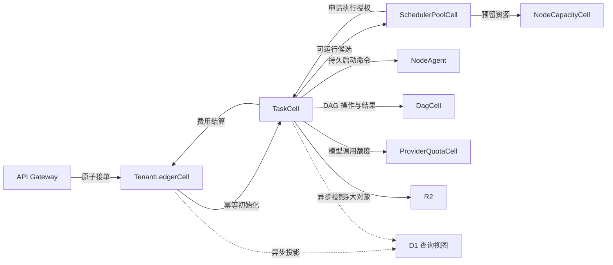

# Celld 微服务持久化设计规范

- **状态**：已确认设计，2026-11-01。
- **实现状态**：待实施。文中的 Cell、表族和协议是目标设计，不代表现有代码已提供相应保证。
- **实施规格**：[Celld 持久化实施规格](../specs/celld_persistence_implementation_spec.md)，包含用户故事、实施决策与外部行为验收；对应 [GitHub Issue #1](https://github.com/echo112400-beep/ansts/issues/1)。
- **适用范围**：接单、队列、调度、租约、执行、DAG、预算、模型配额、Saga、快照、事件、查询、迁移和恢复验收。
- **规范优先级**：本文替代旧文档中冲突的持久化设计、存储选型、幂等规则及未经实测的吞吐、延迟和 RTO 承诺。
- **历史参考**：[微服务架构](microservices_architecture.md)、[Celld HA 方案](celld_persistent_recoverable_ha_scheduler_design.md)、[整体架构](architecture_design_doc.md)、[生产部署架构](ansts_production_deployment_architecture_design.md)。
- **官方依据核验日期**：2026-10-31；运行时升级时重新核对所引用的 Celld 契约。

以业务状态所有权划分 Cell。每次关键修改在所属 Cell 内提交。
跨 Cell 使用持久操作记录、预留和幂等消息推进。

## 1. 已确认的业务承诺

| 项目 | 已确认的约束 |
|---|---|
| 主运行时 | Celld； Cloudflare 双平台兼容硬约束 |
| 故障范围 | 全部 Celld 计算节点丢盘后，关键已确认记录仍可恢复 |
| 确认条件 | 生产 fleet 使用 bucket 模式；对象存储独立于计算节点故障域 |
| 接单成功 | 完整 TaskSpec、初始队列、幂等结果和 outbox 已在同一 Cell 提交 |
| 消费安全 | 预算先预留；未知消耗冻结；无可信上界的调用不能使用严格硬预算 |
| 恢复边界 | 最近完整 Turn 及其快照；已记录的外部操作独立核对 |
| 查询 | D1 为异步查询视图；业务操作回权威 Cell 校验 |
| 迁移 | 允许维护窗口；保留可验证的历史记录 |
| 发布门槛 | 先验正确性和灾备；吞吐、延迟、RTO 由实测签收 |

这里的零丢失以对象存储保持完整为前提。
误删除和对象存储自身灾难，需要独立备份覆盖。

当前部署示例仍配置 fleet 模式。
上线前需要更新部署配置，并验证存储故障域。
证据：[Compose 配置](../deploy/rustfs-celld/docker-compose.rustfs-celld.yml)。

Celld 的 bucket 模式等待对象存储确认。
其保证依赖条件写入、读写一致性和 ranged reads。
RustFS 的 S3 接口名称不能替代这些验证。
依据：[确认模式](https://celld.dev/docs/#ownership-and-durability)、[存储契约](https://celld.dev/docs/guarantees/)。

## 2. 各组件的状态所有权

以下逻辑 Cell 类型是本规范的状态所有权边界。
代码目录可以保留现有微服务划分。

| 权威单元 | 唯一负责的持久状态 | 本地表族与约束 |
|---|---|---|
| TenantLedgerCell，按 tenantId | 接单、完整初始规格、初始队列、幂等、租户政策、预算预留与结算 | admissions、admission_queue、request_dedup、budget_periods、holds、settlements、quota_transfers；幂等键与结算身份唯一 |
| TaskCell，按 taskId | 执行状态、当前租约与业务 epoch、Turn、操作结果、审批、补偿、等待、快照引用 | task_state、execution_lease、turns、operations、approvals、compensations、pending_actions、snapshot_refs；版本 CAS |
| SchedulerPoolCell，按 region/poolId | 池内竞争队列、租户公平份额、派发意图、有效 reservation 引用 | candidates、fairness_accounts、dispatch_operations；份额包含已承诺的资源占用 |
| NodeCapacityCell，按 nodeId | 节点 incarnation、容量、分配、burst 授权、回收记录 | node_state、allocations、burst_grants；reservationId 唯一 |
| DagCell，按 dagId | 图结构、子任务观察结果、join、唯一 winner、额度转移进度 | dag_state、children、barriers、race_decisions、transfer_operations；winner 只能决定一次 |
| ProviderQuotaCell，按供应商凭证与配额域 | 多租户共享的 RPM/TPS 限额及短期额度授予 | provider_policy、rate_grants；不能把共享配额复制给每个 router |
| RoutingConfigCell，按配置分片 | 租户归属、资源池成员关系、路由版本、模型政策和价格版本 | routes、pool_members、policy_versions；缓存携带版本 |

每种 Cell 都包含 inbox、outbox 和 schema_version。
inbox 负责消费去重；outbox 记录尚未完成的发送。

租户账本拥有接单状态；TaskCell 拥有执行状态。
调度候选队列是派生视图，不能单独宣布任务已接收。

DagCell 记录额度转移进度；额度数值由租户账本裁定。
NodeCapacityCell 记录授权；节点代理负责执行和报告实际状态。

API、Dashboard 和 CLI 通过权威接口发命令。
Router 的统计与熔断缓存可以重建。
共享供应商配额和租户预算必须持久授权。
NodeDaemon 的进程句柄、预热池和瞬时指标需要重新发现。
CELLD 的内部 ownership epoch 不作为任务执行 epoch。

### 现有微服务到状态所有者的映射

服务可以部署为无状态工作进程。持久权威由上表中的 Cell 承担。

| 现有组件 | 持久化职责与恢复入口 |
|---|---|
| ansts-api-gateway | 接单与幂等进入 TenantLedgerCell；会话连接和信用窗口可重建 |
| ansts-bayesian-profiler | 从已提交 Turn 样本更新 D1 统计摘要；丢失后用保留样本重训；P50 建议不能替代硬预算授权 |
| ansts-queue-manager | 初始队列在 TenantLedgerCell；运行候选在 SchedulerPoolCell；DAG 结构在 DagCell |
| ansts-core-scheduler | SchedulerPoolCell 持久记录公平份额与派发操作；NodeCapacityCell 裁定可分配容量 |
| ansts-lease-coordinator | 任务租约统一进入 TaskCell；节点 incarnation 进入 NodeCapacityCell；不保留独立可写租约副本 |
| ansts-cognitive-router | TaskCell 保存调用身份和结果；ProviderQuotaCell 授予共享速率额度；价格和政策带版本 |
| ansts-saga-tool-gateway | TaskCell 保存操作意图、结果、审批、补偿与 unknown 状态；大内容进入 R2 并保留引用 |
| ansts-node-daemon | 使用持久资源授权启动与停止；重启后按 incarnation 对账；本地 WAL 仅为缓存 |
| agent-harnessd | 从 TaskCell 的已提交 Turn、操作日志与 R2 快照恢复；进程内状态不承担持久承诺 |
| ansts-checkpoint-manager | R2 保存不可变块与 manifest；TaskCell 决定已提交引用；上传意图与删除清单支持重试 |
| ansts-event-notifier | 从所属 Cell 的 outbox 派发；投递身份与状态持久保存；DLQ 不替代业务待办 |
| FinOps | TenantLedgerCell 是预算与结算权威；D1 报表是查询视图 |
| Dashboard、CLI、SSE | D1 提供列表、统计和持久 feed；写操作回对应权威 Cell |
| Federation、分片与背压模块 | RoutingConfigCell 保存路由及政策版本；健康观察可重建；池间转移遵守同一预留与栅栏协议 |

### 共用事务和消息约束

- 在 Cell 的 SQLite 本地事务中同时修改业务状态、操作记录和 outbox。
- 网络请求与外部 I/O 放在事务之外。等待 I/O 后，重新核对 state_version、epoch 和预留状态。
- 不把单线程 actor 当作跨 await 的互斥锁。不持锁等待供应商、审批或其他 Cell。
- 每个 operationId 对应稳定的操作类型、资源身份和参数摘要。重复请求内容不一致时返回冲突。
- inbox 以 eventId 去重；outbox 对同一事件保持稳定身份；结算以结算身份建立唯一约束。
- 聚合状态使用 expectedVersion 条件修改。epoch 只能由 TaskCell 递增，turnSeq 只按已授权的状态转换推进。
- 使用 transactionSync 执行本地 SQL 原子修改，完整消费写游标。响应边界服从 Celld 的持久化 output gate。
- durability timeout 表示确认结果未知。不得将其解释为已提交事务回滚，也不得通过新 operationId 盲目重做。
- 同一 Cell 的表不能作为其他 Cell 的可直接写入共享表。跨 Cell 不使用共享内存、跨库 JOIN 或隐含分布式事务。

## 3. 接单、派发与回收协议

### 接单

1. 校验租户身份与规范化后的 TaskSpec。
2. 计算请求内容摘要。
3. 在 TenantLedgerCell 查询幂等键。
4. 若已有结果，核对摘要并返回原结果。
5. 若摘要不同，返回冲突。
6. 在一个事务中写入接单四件套。
7. 等待 bucket 持久化确认，再返回 202。

接单四件套是 admission、初始队列、幂等结果和 outbox。
202 承诺任务可恢复；可运行资格仍需预算与资源授权。
TaskCell 初始化失败时，接单 outbox 继续驱动创建。

幂等窗口至少为 24 小时。
任务未终结或结果未知时，不清除对应记录。
窗口外重用键会创建新任务，接口需要明确这个行为。

### 派发

1. TaskCell 核验任务当前可运行。
2. TenantLedgerCell 授予所需的额度预留。
3. SchedulerPoolCell 持久登记 dispatchId。
4. NodeCapacityCell 排他预留节点容量。
5. TaskCell 核对状态版本与预留凭据。
6. TaskCell 提升执行 epoch，并提交启动 outbox。
7. NodeAgent 验证授权后，幂等启动沙箱。
8. 各方按持久记录补齐派发确认。

操作在 PREPARING、RESERVED、AUTHORIZED、STARTED 阶段推进。
重复消息返回已有结果，不重复预留或启动。
TaskCell 拒绝授权后，各方按 dispatchId 释放未使用预留。
授权结果未知时，先查询 TaskCell，再决定释放。

普通任务、恢复任务和 DAG 子任务使用同一容量入口。
池内公平份额计入已预留、启动中和运行中的资源。
跨池通过额度分配与周期调整近似公平。
快速阶段切换消耗节点已获授权的 burst 额度。

### 接管和停止

心跳超时首先触发怀疑与核对。
TaskCell 是新业务 epoch 的唯一签发者。
节点代理、工具入口、结果入口校验精确的当前授权。
客户端不能自行提交更高 epoch 获得权限。

接管后，旧执行者的结果被拒绝。
已发送的外部请求仍需查询或人工核对。
旧沙箱未停止或隔离前，不复用它占用的容量。
节点重启后使用新 incarnation，并对账旧分配。

热租户先背压，不自动拆分租户预算账本。
账本分片需要另行验证额度守恒与迁移协议。

## 4. Turn、快照和外部副作用

### 完整 Turn 的提交

1. 在 TaskCell 记录快照上传意图。
2. 上传租户隔离的不可变数据块。
3. 校验块大小与独立 SHA-256 摘要。
4. 生成完整 manifest。
5. 在同一事务提交 Turn、manifest 引用和状态版本。
6. 同时写入预算结算与业务事件 outbox。
7. 等待 bucket 确认，再宣布 Turn 完成。

manifest 可以复用先前已验证的数据块。
每个已提交 Turn 都必须能解析出完整工作区。
上传失败只留下可识别的临时对象。
恢复只读取已提交且校验通过的 manifest。
发现缺失块时阻塞恢复并告警，不伪造成功。

R2 ETag 不作为 SHA-256 使用。
大文件采用应用层分块与持久上传进度。
Celld multipart 上传不能跨节点或重启续传。
依据：[R2 行为](https://celld.dev/docs/services/r2/)。

### 外部操作

每次逻辑操作先记录稳定 operationId、参数摘要和执行意图。
operationId 跨重试、接管和 epoch 变化保持不变。
attemptId 与执行 fence 独立记录。

| 工具类别 | 恢复规则 |
|---|---|
| PURE_READ | 按策略重读；记录结果来源与时间 |
| IDEMPOTENT_WRITE | 使用稳定幂等键查询或重试 |
| SAGA_COMPENSATABLE | 持久记录结果与补偿进度；补偿可以失败 |
| STAGED_COMMIT | 保存审批绑定的参数摘要；批准后执行指定操作 |
| 结果不明 | 查询供应商；无查询和幂等能力时进入 OUTCOME_UNKNOWN |

审批绑定逻辑操作、参数摘要与授权范围。
参数变化后必须重新审批。
恢复不能把 RUNNING 操作直接当作未执行。
完整 Turn 之前已记录的工具结果也必须恢复。
计算回滚不回滚费用账本和外部操作历史。

TaskCell 保存 deadline、待办和事件 inbox。
alarm 指向最近到期项，唤醒后批量推进。
周期 reconciler 修复漏唤醒和长时间未推进的记录。
Workflows 可以编排辅助作业，但不另持有任务业务真相。
依据：[Workflows 重放语义](https://celld.dev/docs/services/workflows/)。

## 5. 额度、计费与 DAG 守恒

### 预算与供应商配额

TenantLedgerCell 在调用前冻结保守费用上界。
预留包含币种、计费周期和价格版本。
结算以 provider usage 或可核验凭据为准。
金额使用整数最小单位，避免浮点累计误差。
不把字符数估算作为最终账单凭据。

调用结果不明时，对应预算继续冻结。
切换备用模型前，需要为新请求另行预留。
不能把旧请求的未知费用当作已释放。
供应商无法提供可信费用上界时，拒绝严格硬预算调用。

ProviderQuotaCell 分配有期限的速率额度块。
Router 在授权额度内快速处理请求。
重启或网络分区后，未确认的授予不能重复发放。
熔断统计可重建；权威限额不能依赖实例内 Map。

### DAG

DagCell 决定图结构、join 和唯一 winner。
TaskCell 决定父任务是否已进入安全挂起状态。
TenantLedgerCell 原子记录父子额度转移。
子任务只有拿到有效转移授权后才能消费额度。

voucherId 唯一，并绑定租户、父子任务和转移操作。
签名用于验证来源，不能证明额度尚未兑换。
重复 spawn、兑换、回收和 boost 不得重复改变余额。
父任务恢复前核对 barrier 与未结算额度。
零子任务视为立即完成，不让父任务永久挂起。

Race 分支默认限制为读取或隔离写入。
不可逆外部提交在选出 winner 后授权。
loser 先停止并结算，再回收它的额度。

## 6. 消息、查询和数据生命周期

每条消息包含 eventId、operationId 和 aggregateVersion。
消息还包含 tenantId、schemaVersion 和内容摘要。
消费者在同一事务完成 inbox 去重和业务修改。
乱序消息依据聚合版本补齐，不能用旧事件覆盖新状态。

outbox 保存 attempts、nextAttemptAt 和最后错误。
发送确认丢失时，重发相同 eventId。
重试耗尽后进入可查询的阻塞状态。
人工重放仍使用原操作身份。
未完成 outbox 不按普通历史期限清除。

Queue 和 alarm 只负责唤醒推进。
周期 reconciler 从 Cell 的未完成记录补派发。
任务与租户注册目录由接单事务驱动维护。
对账不能只依赖进程内 Cell 列表。
依据：[Queue 四天保留期](https://celld.dev/docs/services/queues/)。

D1 按查询负载分库，保存可重建的异步视图。
各库有消费去重表、来源版本和持久 feed 游标。
SSE 游标表示指定 feed 的位置。
不承诺跨任务的全局发生顺序。

临时 token 流可以丢失，已提交结果可补齐。
超出事件窗口时，返回明确的重新同步响应。
取消、审批和预算检查始终回权威 Cell。

| 数据 | 默认期限 | 清理条件 |
|---|---|---|
| SSE 业务事件 | 7 天 | 超期客户端改读任务快照 |
| 终态任务完整内容与快照 | 30 天 | 无未决补偿、操作和有效恢复引用 |
| 任务摘要、结算与操作审计 | 365 天 | 满足租户配置的保留期限 |
| 活跃任务和未决记录 | 解决前保留 | 不自动遗忘 unknown、预算 hold 和待补偿操作 |
| 接单幂等记录 | 至少 24 小时 | 任务已终结且不存在未知结果 |

对象 GC 先撤销业务引用并记录 tombstone。
宽限期后，再按持久删除清单删除无引用对象。
存在未决引用时保守保留。
Celld LTX 回收不能替代业务 GC 或独立备份。

## 7. 升级、迁移和验收

### 升级与备份

固定 Worker script 和 Cell class 名称。
Cell 身份变化需要显式数据迁移。
业务 SQL 使用自己的 schema_version。

短迁移在本地事务执行；长回填分批推进。
相邻版本的请求和消息协议保持兼容。
依据：[Cell 身份与迁移限制](https://celld.dev/docs/services/durable-objects/)。

独立备份保存 bucket 数据及可验证的恢复切点。
恢复切点覆盖元数据、快照引用和对象块。
首版采用维护窗口停写备份，避免假设在线全局快照。
备份恢复到隔离 fleet，演练后才算可用。
备份窗口后的写入损失范围单独记录。

### 从现有实现迁移

1. 暂停接单和新的副作用授权。
2. 对在途任务逐项核对并导出可读取状态。
3. 备份当前 bucket 和可用节点数据。
4. 迁移 TaskSpec、租约、操作与预算记录。
5. 校验任务数、余额、额度与快照引用。
6. 对未知记录建立显式人工处理清单。
7. 在隔离环境执行恢复与重复消息演练。
8. 完成切换后恢复流量。

内存中已经丢失的历史无法由迁移脚本重建。
无法验证的记录不得伪造为已完成。
当前内存版 durability proof 不进入生产确认链。
Celld 自身负责底层 SQLite 的复制和 ownership。
应用层只实现业务 WAL、操作身份和业务执行栅栏。

### 分档验收

| 场景 | 必须满足的结果 |
|---|---|
| 202 后立即销毁全部计算节点磁盘 | 从保留的对象存储找回同一任务与幂等结果 |
| 提交后响应丢失 | 使用原 operationId 找到原结果或继续核对 |
| 派发任一阶段崩溃 | 同一 dispatch 不重复启动；接管授权有序；节点容量不超分 |
| 旧执行者继续运行 | 拒绝旧 fence 的结果和新操作授权 |
| 子任务与结算消息重复或乱序 | winner 唯一，额度和金额守恒 |
| 快照上传中断 | 已确认 Turn 的全部引用仍可读取 |
| 外部效果成功但结果保存失败 | 查询原操作或阻塞为 unknown，不盲目重试 |
| Queue 过期或 alarm 重试耗尽 | reconciler 从持久待办恢复推进 |
| D1 视图丢失 | 重建视图，权威业务记录保持可用 |
| 备份恢复 | 在隔离 fleet 验证任务、账本和工作区完整性 |

保留十万沙箱、五万 Turn/s 为远期目标。
压测分别报告活跃与休眠任务规模。
同时报告租户倾斜、资源池数量与快照大小。
测量 202、派发、Turn 提交、恢复各自的分位延迟。
这些结果与对象存储吞吐和成本一起签收。
本规范不沿用未经验证的旧 RTO 数字。

## 8. 实施顺序与发布门禁

| 阶段 | 交付范围 | 验收门禁 |
|---|---|---|
| 1. 持久接口基础 | 稳定 Cell 身份、schema_version、operationId、inbox/outbox、本地事务封装 | 提交后响应丢失与重复请求不造成重复效果 |
| 2. 接单与任务恢复 | TenantLedgerCell、TaskCell、完整规格和业务状态恢复 | 202 后销毁计算节点，仍能找回同一任务 |
| 3. 资源与执行授权 | SchedulerPoolCell、NodeCapacityCell、任务 epoch、节点 incarnation | 所有派发路径不超分；旧执行者不能获得新操作授权 |
| 4. 预算与模型调用 | 金额预留、价格版本、ProviderQuotaCell、usage 结算 | 并发、重试、fallback 和 unknown 情况下额度守恒 |
| 5. 副作用与快照 | 操作日志、审批、补偿、块校验、Turn 与引用原子提交 | 外部结果不明时不盲重试；已确认 Turn 可恢复 |
| 6. DAG 与查询通知 | DagCell、额度转移、D1 投影、SSE、Webhook 和 reconciler | 重复乱序不重复结算；消息过期仍能推进持久待办 |
| 7. 运维与容量验证 | 停写迁移、GC、独立备份、灾备演练、分档压测 | 满足第 7 节故障场景后，再签收容量与 RTO |

发布前必须完成以下验证，并保存结果：

- 核实所选对象存储的条件写、读取一致性与 ranged reads；完成 Celld 存储诊断和故障测试。
- 核实对象存储与计算节点的实际故障域。Compose 示例或 EC 参数本身不构成验证证据。
- 以所有计算节点丢盘为故障注入场景，验证已确认的接单、Turn、预算和操作记录。
- 在具体数据量和租户倾斜下测量热点 Cell、对象存储请求量、吞吐、延迟及恢复耗时。
- 在隔离 fleet 恢复独立备份，核对任务、金额、额度、操作日志与全部有效快照引用。

这些验证是生产实施的验收工作；本次设计文档变更不宣称它们已经完成。
