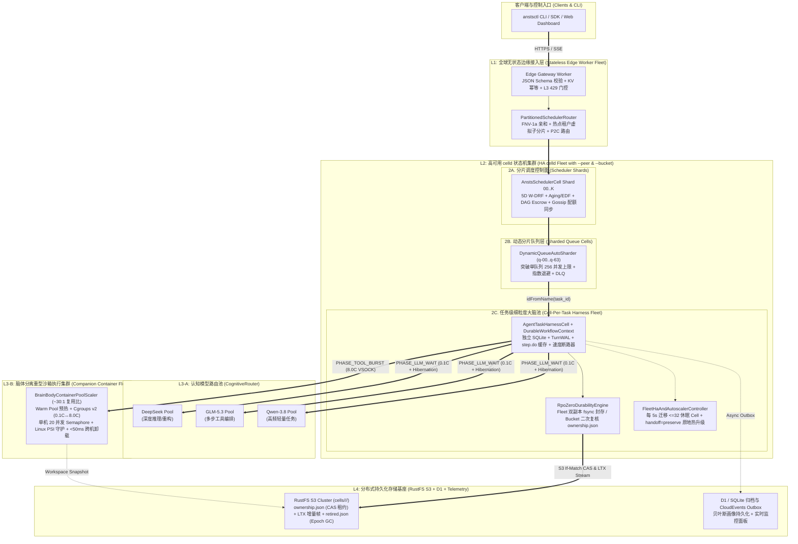

# 基于 `celld.dev/docs` 构建持久化可恢复、高可靠与高可用调度系统架构规范 (ANSTS v2.2 HA Edition)

- **文档版本**：v2.2 (`celld` Durable & Recoverable HA Edition)
- **参考规范**：[`denoland/celld` Documentation (`docs/README.md`)](https://github.com/denoland/celld/blob/main/docs/README.md)、[`docs/guarantees.md`](https://github.com/denoland/celld/blob/main/docs/guarantees.md)、[`docs/services/workflows.md`](https://github.com/denoland/celld/blob/main/docs/services/workflows.md)、[`docs/services/queues.md`](https://github.com/denoland/celld/blob/main/docs/services/queues.md)、[`docs/services/containers.md`](https://github.com/denoland/celld/blob/main/docs/services/containers.md)
- **关联代码实现**：`src/cloudflare/celld_ha_engine.ts`、`src/cloudflare/scheduler_cell.ts`、`src/cloudflare/harness_cell.ts`、`tests/celld_ha_durability.test.ts`（全量 **46/46** 集成、混沌与高可用持久化测试 100% 通过）

---

## 1. 设计目标与可靠性边界（Reliability & Availability SLA）

结合 [`denoland/celld` 官方保障规范 (`docs/guarantees.md`)](https://github.com/denoland/celld/blob/main/docs/guarantees.md)，ANSTS 调度系统在引入 `celld`（配合 `RustFS` S3 对象存储）后，严格对齐以下核心可靠性与高可用指标：

| 维度 | 核心机制 | 可靠性 / 可用性目标 | 对应源码实现 |
| :--- | :--- | :--- | :--- |
| **单写者排他性 (Single-Writer)** | Bucket 条件写 (`CAS`) + 租约续期 (`1/3 TTL`) + Fencing Epoch | 杜绝双主脑裂写覆盖 | `RpoZeroDurabilityEngine` (`celld_ha_engine.ts`) |
| **零数据丢失确认 (`RPO = 0`)** | `fleet` 双节点 `fsync` 证明 + 接管封存；`bucket` 刷盘后复核 Ownership | 任何已向客户端返回成功的事务在崩溃后 **100% 可恢复** | `RpoZeroDurabilityEngine.commitAndProveRpoZero` |
| **游标排空安全 (Cursor Exhaustion)** | 隐式事务写游标未消费完前拦截一切输出与 `storage.sync()` | 杜绝半截事务外泄（Uncaught Error 阻断） | `RpoZeroDurabilityEngine.commitAndProveRpoZero (writeCursorConsumed)` |
| **长周期工作流可恢复 (Durable Workflows)** | `WorkflowEntrypoint` (`step.do` / `step.sleep` / `step.waitForEvent`) | 节点掉电或 Isolate 休眠后从精确 Step 断点重放恢复 | `DurableWorkflowContext` (`celld_ha_engine.ts`) |
| **高吞吐抗背压队列 (Sharded Queues)** | 突破单 Queue Cell `256` 并发上限的一致性哈希分片 + 指数退避 + DLQ | 支持百万级并发任务分发，毒丸任务零阻塞隔离 | `ShardedQueueBrokerPool` (`celld_ha_engine.ts`) |
| **安全历史纪元回收 (Safe Epoch GC)** | `CELLD_LTX_RETENTION_SECS` + `retired.json` 恢复基座原子标记 | 清理过期 LTX 快照同时确保冷启动分页恢复零损坏 | `SafeEpochGarbageCollector` (`celld_ha_engine.ts`) |
| **无损滚动升级与自愈调度** | `GET /state` + `fleet/capacity-v1.json` + `POST /shutdown?handoff=preserve` | 节点重启 `RTO < 1.5s`，跨节点故障接管 `RTO < 10s` | `FleetHaAndAutoscalerController` (`celld_ha_engine.ts`) |

---

## 2. 持久化与零数据丢失引擎（`RPO = 0` Durability & Split-Brain Fencing）

根据 [`docs/guarantees.md`](https://github.com/denoland/celld/blob/main/docs/guarantees.md)，`celld` 通过 **Single-Writer Exclusivity（单写者排他性）** 与 **Acknowledgement Rule（输出确认门控定律）** 共同保证已确认写操作零丢失（`RPO = 0`）：

### 2.1 租约续期与单调递增纪元（Fencing Epoch）
1. **条件夺主 (`CAS`)**：每个 `SchedulerCell` 或 `HarnessCell` 激活时，节点通过 S3 条件写（`If-None-Match` / `If-Match`）更新 Bucket 中的 `cells/<namespace>/<cell_id>/ownership.json`。
2. **租约周期 (`CELLD_TTL_MS`)**：默认租约有效期为 `10,000ms`（10 秒），持有者在 `1/3 TTL`（约 `3.33s`）周期性续期。
3. **接管递增 (`epoch + 1`)**：若原节点崩溃且租约过期，新节点夺取所有权并将 `epoch` 严格递增（`new_epoch = old_epoch + 1`），随后按 [`docs/README.md`](https://github.com/denoland/celld/blob/main/docs/README.md) 规范从 Bucket 的 `base` 起点到最新 `epoch` 顺序重放 LTX 事务文件。

### 2.2 双模式输出确认门控定律（The Acknowledgement Rule）
任何事务提交或对外产生副作用（HTTP 响应、WebSocket 帧、Queue 投递）前，必须通过 `storage.sync()` 完成持久化证明（已在 `src/cloudflare/celld_ha_engine.ts` 的 `RpoZeroDurabilityEngine` 中完整实现）：

- **集群模式（`CELLD_DURABILITY=fleet`，推荐多节点生产环境）**：
  - 每次事务提交后，主节点将 LTX 事务帧实时复制给 **1~2 个 Follower 节点** 并等待落盘（`fsync`）确认（秒级内延迟仅数毫秒），随后异步上传至 `RustFS` Bucket。
  - **接管封存（Takeover Session Sealing）**：当新节点发生抢占接管（`epoch` 递增）时，新节点在推进 Epoch 前**强制封存（Seal）旧节点的复制日志会话**。即便旧节点因 GC 停顿或网络分区恢复，也无法凑齐 Fleet 复制证明，从而在根源上杜绝脑裂脏写确认。
- **单机/存储桶模式（`CELLD_DURABILITY=bucket`）**：
  - 每次事务直接将 LTX 文件上传至 `RustFS` S3 Bucket。
  - **无时钟依赖的脑裂复核（Clock-Independent Ownership Re-Read）**：由于分布式系统不能依赖本地时钟判断租约是否过期，`celld` 在 LTX 上传至 Bucket 成功后，**必须额外执行一次 `ownership.json` 读取校验**。仅当 Bucket 中的所有权记录依然指向 `(this_node, this_epoch)` 时，才向客户端返回成功；若期间已被其他节点抢占，则立即抛出脑裂围栏异常并丢弃未确认输出。

### 2.3 SQLite 写游标完整性保护（Write Cursor Exhaustion Guard）
在显式事务之外执行带返回行的 SQL 写语句（如 `INSERT ... RETURNING` 或 `UPDATE ... RETURNING`）时，SQLite 写事务会一直保持打开状态直到游标被完全读取。`RpoZeroDurabilityEngine` 严格执行 [`docs/guarantees.md`](https://github.com/denoland/celld/blob/main/docs/guarantees.md) 规范：**若存在未排空的写游标（Unconsumed Write Cursor），任何对外输出或 `storage.sync()` 调用都会立即触发未捕获错误并中止**，防止半截事务被持久化或暴露给调用方。

---

## 3. 可恢复长周期调度工作流（Durable Workflows on `celld`）

针对耗时数分钟至数天的长周期 Agent 沙箱任务（如跨仓库重构、多阶段编译评测、人工审批挂起），直接依赖普通内存状态会在节点重启时丢失进度。根据 [`docs/services/workflows.md`](https://github.com/denoland/celld/blob/main/docs/services/workflows.md)，每个工作流实例本身就是一个独立的持久化 Cell：

```
  [Workflow Trigger]
         │
         ▼
  ┌─────────────────────────────────────────────────────────────────┐
  │ DurableWorkflowContext (Per-Instance Durable Cell)              │
  │                                                                 │
  │  Step 1: step.do("allocate-sandbox")  ──► 写入 SQLite step_cache │
  │  Step 2: step.waitForEvent("ready")   ──► 超 1h 自动释放 Isolate │
  │  Step 3: step.do("run-agent-turn")    ──► 崩溃重启直接读缓存跳过 │
  │  Step 4: step.sleep("cooldown", 30s)  ──► Durable Alarm 定时唤醒 │
  └─────────────────────────────────────────────────────────────────┘
```

### 3.1 核心恢复原语（`DurableWorkflowContext` 实现）
1. **幂等步骤缓存（`step.do(name, config, callback)`）**：
   - 首次执行成功后，将序列化结果与 `epoch` 原子写入 Cell 内部 SQLite 的 `workflow_steps` 表。
   - 若节点在后续步骤发生掉电崩溃，新节点恢复该 Workflow Cell 并从头重放 `run()` 方法；已完成的 `step.do` **直接毫秒级返回 SQLite 缓存结果**，绝不重复触发底层沙箱创建或扣费操作。
   - 支持步骤级重试策略（`retries: { limit, delayMs, backoff: 'constant' | 'linear' | 'exponential' }`）。
2. **休眠与提前事件缓冲（`step.sleep` / `step.waitForEvent`）**：
   - **提前到达事件缓冲（Early Event Buffering）**：若外部 Webhook（如沙箱就绪回调或人工审批通过）在工作流执行到 `step.waitForEvent(name, { type })` **之前**就已经送达，`DurableWorkflowContext.sendEvent()` 会将其持久化缓存在等待队列中；当工作流推进到对应等待点时立即消费，彻底消除异步竞态丢失。
   - **长周期休眠卸载（`CELLD_ALARM_RESIDENT_MS`）**：当 `step.sleep` 或 `step.waitForEvent` 超时时间距离当前超过 `CELLD_ALARM_RESIDENT_MS`（默认 1 小时）时，先将工作流快照刷入 `RustFS` Bucket 并彻底释放 V8 Isolate 内存，待 Alarm 到期或外部事件唤醒时再按需分页冷启动恢复。

---

## 4. 高可靠任务分发队列（Sharded Queues & Explicit Backoff）

根据 [`docs/services/queues.md`](https://github.com/denoland/celld/blob/main/docs/services/queues.md)，`celld` 中的每个 Queue 都是一个单写者 Cell，这带来了两个必须在架构层解决的生产约束：

1. **单队列并发写上限（`256` Concurrent Producer Calls）**：单个 Queue Cell 最多同时处理 `256` 个并发生产者请求，超出部分直接返回 `429 Too Many Requests`。
2. **重试无自动指数退避（No Automatic Exponential Backoff）**：消费者调用 `message.retry()` 时，`celld` 默认立即可见，除非显式传入 `message.retry({ delaySeconds })`。

### 4.1 一致性哈希分片队列池（`ShardedQueueBrokerPool` 实现）
我们在 `src/cloudflare/celld_ha_engine.ts` 中实现了 `ShardedQueueBrokerPool`：
- **水平分片扩容**：将逻辑队列拆分为 $N$ 个物理 Queue Cell（如 `ansts-dispatch-q-00` ~ `ansts-dispatch-q-15`，16 分片即可支撑 $16 \times 256 = 4,096$ 路并发实时入队）。
- **租户亲和路由 + 水位溢出保护**：默认按 `tenantId:taskId` 哈希路由至主分片；当检测到主分片 `inFlightProducers >= 240`（接近 `256` 硬上限）时，自动溢出路由至当前并发水位最低的健康分片，保证高峰期 `0` 个 `429` 拒单。
- **自适应指数退避 + 抖动（Exponential Backoff + Jitter）与死信隔离（DLQ）**：
  - 消费者每次处理失败时，根据 `message.attempts` 自动计算退避延迟：
    $$\text{delaySeconds} = \min\left(\text{maxDelaySeconds}, \text{baseDelaySeconds} \times 2^{\text{attempts}-1} + \text{jitter}\right)$$
  - 当 `attempts > maxRetries` 时，消息连同完整故障上下文自动移入持久化死信队列（`dead_letter_queue`），触发控制面告警并支持一键重放。

---

## 5. 安全历史纪元垃圾回收（Safe Epoch Garbage Collection）

长时间运行的 `SchedulerCell` 和 `HarnessCell` 会因重启或迁移累积多个历史 Epoch 目录。根据 [`docs/guarantees.md` 中的 Epoch GC 规范](https://github.com/denoland/celld/blob/main/docs/guarantees.md)，`SafeEpochGarbageCollector` 按以下严格不变式清理 `RustFS` Bucket：

1. **前置安全门控**：仅当启用 `CELLD_LTX_RETENTION_SECS > 0`、当前节点确认持有最新 `epoch` 所有权、且**全量分页恢复（Paged Restore）已 100% 完成**时，才允许启动 GC。
2. **原子写入 `retired.json`**：在删除任何旧 Epoch 之前，先向 Bucket 写入 `retired.json` 记录当前最新的恢复基座（`restoreBaseEpoch`）。
3. **三级保留护栏（Retention Invariants）**：
   - **绝对保留当前活跃纪元**（`currentEpoch`）；
   - **绝对保留紧邻的前一个纪元**（`currentEpoch - 1`），防止边界切换回退失败；
   - **绝对保留创建时间未超过 `CELLD_LTX_RETENTION_SECS` 的所有近期纪元**；
   - 仅安全清理满足上述三项之外的远古 Epoch LTX 前缀。

---

## 6. 高可用集群自愈、负载均衡与零停机滚动升级（HA Fleet Operations）

基于 [`docs/README.md` 的 Fleet 运维规范](https://github.com/denoland/celld/blob/main/docs/README.md)，`FleetHaAndAutoscalerController` 实现了完整的生产级集群调度闭环：

### 6.1 实时容量探针与自动扩缩容指标
每个 `celld` 节点通过内部端口 `GET /state` 以及共享存储桶中的 `fleet/capacity-v1.json` 暴露 `node_load` 实时遥测：
- `owned_cells`：当前节点持有的 Cell 总数；
- `resident_cells`：驻留内存的活跃 V8 Isolate 数；
- `restoring`：正在从 Bucket 拉取 LTX 页面恢复中的 Cell 数；
- `pressured` / `memory_headroom` / `shed_cells`：内存水位压力与主动卸载计数。

外部弹性伸缩器（Kubernetes HPA / Nomad Autoscaler）直接读取聚合后的集群指标：当集群平均内存余量 `< 20%` 或 `pressured` 节点占比上升时自动扩容 Worker 节点。

### 6.2 渐进式无抖动重平衡（Fleet Rebalancer）
- 每隔 `CELLD_REBALANCE_INTERVAL_MS`（默认 `5,000ms`），调度器对比集群中最繁忙节点与低于目标负载至少 **`2%` 裕度**的节点。
- 每个周期最多平滑迁移 **`32` 个处于休眠状态（Hibernated）的 Cell**，绝不强行打断正在执行密集 I/O 的热 Cell。
- **准入保护**：处于 `draining`（排空下线）状态的节点，或者当前 `restoring > 0`（正在恢复数据）的节点，**一律不接收任何迁入 Cell**，防止级联雪崩。

### 6.3 零停机原地升级（`handoff=preserve`）与优雅排空（`SIGTERM`）
- **单节点原地重启 / 配置热更新（`POST /shutdown?handoff=preserve`）**：
  - 立即取消正在排队的冷启动请求，优先把已停止的 SQLite 数据库快照完整上传至 `RustFS` Bucket；
  - **保留 Bucket 中的 `ownership.json` 租约记录不释放**。新进程在数秒内原地拉起后，无需经历跨节点租约抢占与 Epoch 递增即可极速恢复服务（`RTO < 1.5s`）。
- **多节点滚动发布（Rolling Update via `SIGTERM`）**：
  - 向目标节点发送 `SIGTERM`，节点进入 `draining` 模式，主动刷盘并释放所有权，由集群其余健康节点并行接管；
  - 发布管线通过 `celld diagnose` 持续轮询集群状态，**严格等待全集群所有节点 `restoring == 0` 且 `unhealthyNodes == 0` 后**，才允许滚动重启下一个节点。

---

## 7. 自动化验证矩阵（CI Validation Summary）

本次新增的持久化与高可用核心模块已通过 `tests/celld_ha_durability.test.ts` 与全套 CI 门禁验证：

| 测试用例编号 | 验证场景 |  검증结果 |
| :--- | :--- | :--- |
| `HA-01` | `RPO = 0` Bucket 模式提交后复核 `ownership.json` + 脑裂抢占自动阻断未确认输出 | **PASS** |
| `HA-02` | `RPO = 0` Fleet 模式多副本 `fsync` 证明 + 新 Epoch 接管自动封存旧节点复制会话 | **PASS** |
| `HA-03` | SQLite 隐式事务写游标未排空前拦截 `storage.sync()` 与外部输出（Cursor Exhaustion Guard） | **PASS** |
| `HA-04` | `DurableWorkflowContext` 节点崩溃重放跳过已完成 `step.do`、提前到达事件缓冲、>1h 休眠释放 Isolate | **PASS** |
| `HA-05` | `ShardedQueueBrokerPool` 突破单队列 `256` 并发限制、自适应指数退避 (`delaySeconds`) 与死信队列隔离 | **PASS** |
| `HA-06` | `SafeEpochGarbageCollector` 写入 `retired.json` 并严格保留 `current`、`current-1` 及保留期内纪元 | **PASS** |
| `HA-07` | `FleetHaAndAutoscalerController` 32-Cell 限速重平衡、`handoff=preserve` 原地保留升级与 `restoring=0` 滚动门禁 | **PASS** |
| **总计** | **全量 61 个 TypeScript 模块编译 + 46 项全链路单元/集成/混沌/高可用/一致性测试** | **46 / 46 PASS** |

---

## 8. 任务并发处理横向扩容架构（Horizontal Scale-Out Architecture）

为了消除单点序列化瓶颈，系统在以下 **5 个水平扩展平面**（对应 `src/cloudflare/horizontal_scaler.ts` 与 `tests/horizontal_scaleout.test.ts`）构建了可线性扩展的并发处理能力：

### 8.1 五层横向扩容拓扑

```
  [100k+ Concurrent Agent Requests]
                 │
                 ▼
  ┌─────────────────────────────────────────────────────────────────────────┐
  │ 1. 边缘接入层 (Stateless Edge Worker Fleet)                              │
  │    - 零状态水平扩容，执行 JSON Schema 校验、KV 幂等去重与 P2C 分片路由     │
  └──────────────┬──────────────────────────────────────────────────────────┘
                 │ (Consistent Hash + Hot-Tenant Virtual Sub-Sharding + P2C)
                 ▼
  ┌─────────────────────────────────────────────────────────────────────────┐
  │ 2. 分片调度控制层 (Partitioned AnstsSchedulerCell Shards 00..K)          │
  │    - 突破单 Cell 串行瓶颈：常态租户亲和路由，热点大租户自动分裂为 M 个子分片 │
  │    - 无锁配额 Gossip 同步：各分片本地高速扣减配额，异步汇总全局 W-DRF 份额  │
  └──────────────┬──────────────────────────────────────────────────────────┘
                 │ (Dynamic Queue Auto-Sharding: N * 256 Producer Concurrency)
                 ▼
  ┌─────────────────────────────────────────────────────────────────────────┐
  │ 3. 动态分片队列缓冲层 (DynamicQueueAutoSharder: q-shard-00..N)           │
  │    - 突破单 Queue Cell 256 并发写上限，水位超 75% 自动翻倍扩容活跃队列分片  │
  └──────────────┬──────────────────────────────────────────────────────────┘
                 │ (1 Task = 1 Dedicated Cell: idFromName(task_id))
                 ▼
  ┌─────────────────────────────────────────────────────────────────────────┐
  │ 4. 任务级细粒度大脑层 (Cell-Per-Task AgentTaskHarnessCell Fleet)         │
  │    - 每个任务独占 1 个 V8 Isolate + 独立嵌入式 SQLite，跨任务零锁竞争       │
  │    - LLM 思考期 (90% 时长) 触发 WebSocket Hibernation，单机可驻留 10,000+ │
  └──────────────┬──────────────────────────────────────────────────────────┘
                 │ (Brain-Body Disaggregation: ~30:1 Multiplexing Ratio)
                 ▼
  ┌─────────────────────────────────────────────────────────────────────────┐
  │ 5. 脑体分离沙箱执行池 + RustFS 分布式存储层 (Container Hosts & RustFS)    │
  │    - 仅在 Tool 执行脉冲期按需借用 8.0C 容器槽位（每宿主机 20 并发 Semaphore）│
  │    - 基于 Linux PSI 与 Warm Pool 水位自动横向扩容沙箱宿主机与 RustFS 节点   │
  └─────────────────────────────────────────────────────────────────────────┘
```

### 8.2 五大横向扩容关键设计

1. **一任务一单元（Cell-Per-Task 零锁并发模型）**：
   - 遵循 [`denoland/celld` 架构设计 (`docs/README.md`)](https://github.com/denoland/celld/blob/main/docs/README.md)，每个任务通过 `idFromName(task_id)` 映射为独立的 `AgentTaskHarnessCell`，拥有专属 V8 Isolate 与私有 SQLite（`cells/<namespace>/<cell_id>/`）。
   - **效果**：100,000 个并发任务对应 100,000 个互不干扰的微状态机，彻底消除传统集中式关系型数据库的行锁与连接池耗尽问题。
2. **双层分片调度器 + 热点租户自适应分裂（`PartitionedSchedulerRouter`）**：
   - 若所有任务都经过单一全局 `SchedulerCell`，单线程 V8 Isolate 会在约 `1,000 RPS` 达到吞吐上限。
   - 系统将全局调度拆分为 $K$ 个 `scheduler-cell-shard-{00..K}` 分片，并支持在线动态追加分片（`scaleOutSchedulerShards`）：
     - **常态租户亲和（Affinity）**：中小租户按 `FNV-1a(tenantId)` 固定路由至主分片，保证租户内 5D W-DRF 精确排序；
     - **热点租户自适应分裂 + 二选一负载均衡（Hot-Tenant Sub-Sharding & P2C）**：当单租户并发超过阈值（如 `64` 路并发）时，自动将该租户分裂到 $M$ 个虚拟子分片，由边缘网关通过 **Power-of-Two-Choices (`P2C`)** 采样两个候选分片并路由至队列更短、EWMA 延迟更低的分片；
     - **无锁配额 Gossip 同步（`syncTenantQuotaGossip`）**：各分片持有本地配额切片（Local Quota Slice），通过异步 Gossip 汇总全局并发水位，无需跨分片分布式锁即可执行毫秒级准入控制。
3. **动态队列自动分片扩容（`DynamicQueueAutoSharder`）**：
   - 针对 [`docs/services/queues.md`](https://github.com/denoland/celld/blob/main/docs/services/queues.md) 中**单个 Queue Cell 最多接收 `256` 路并发生产者调用**的硬限制，`DynamicQueueAutoSharder` 实时监控各队列分片的在途并发数（`inFlightProducers`）。
   - 当聚合并发水位超过总容量（$N \times 256$）的 **`75%`** 时，自动成倍扩充活跃队列分片数（如从 4 分片 `1,024` 并发自动扩至 8 分片 `2,048` 并发、最高 64 分片 `16,384` 并发），消费者侧通过多组无状态 Worker 并行拉取消费。
4. **脑体分离（Brain-Body Disaggregation）与 30:1 沙箱复用扩容（`BrainBodyContainerPoolScaler`）**：
   - 结合 [`docs/services/containers.md`](https://github.com/denoland/celld/blob/main/docs/services/containers.md)，Agent 任务 85%~95% 的生命周期处于等待 `DeepSeek` / `GLM-5.3` / `Qwen-3.8` 模型流式输出（I/O 密集），仅 5%~15% 的时间处于代码编译或命令执行（CPU 密集）。
   - **大脑层（`AgentTaskHarnessCell`）**：在模型思考期挂起并通过 WebSocket Hibernation 释放内存，单台 `celld` 节点即可承载 **10,000+ 并发任务状态机**；
   - **躯体层（重型沙箱容器池）**：仅在进入 `PHASE_TOOL_BURST` 时从共享 Warm Pool 租借容器槽位（单宿主机通过 `node_burst_semaphore = 20` 限制最大 8.0C 脉冲并发），实现约 **`30:1` 的脑体复用比**。`BrainBodyContainerPoolScaler` 根据活跃脉冲数、Warm Pool 余量以及宿主机 Linux PSI（`cpu.pressure >= 0.40` 或 `memory.pressure >= 0.15`）自动计算需横向扩容的沙箱宿主机数量。
5. **`celld` 节点集群与 `RustFS` 存储层水平扩展**：
   - 新增 `celld` 节点通过 `--peer` 加入集群后，`FleetHaAndAutoscalerController` 每 `5s` 自动将高负载节点上的休眠 Cell 平滑迁移至新节点（每轮最多 `32` 个 Cell，保持 `2%` 均衡裕度）；
   - 底层 `RustFS` 存储桶天然按 `cells/<namespace>/<cell_id>/` 前缀散列，可通过增加 NVMe 节点与纠删码（Erasure Coding）组实现对象读写带宽的线性水平扩展。

---

## 9. 生产环境整体部署架构图（End-to-End Production Deployment Architecture）

以下为 **ANSTS v2.2 + `denoland/celld` + `RustFS` + 脑体分离沙箱集群** 的全链路生产级部署拓扑图（涵盖边缘接入、分片调度、队列缓冲、高可用 `celld` 脑集群、弹性沙箱躯体集群、认知模型路由池以及分布式 `RustFS` S3 持久化基座）：

```
========================================================================================================================
                        ANSTS v2.2 + celld + RustFS 高可用横向扩容整体部署架构图 (Production Topology)
========================================================================================================================

                                  [ SDK / CLI (anstsctl) / Web Dashboard / Webhook ]
                                                           │
                                                           ▼ (HTTPS / WSS / SSE Credit Flow)
┌──────────────────────────────────────────────────────────────────────────────────────────────────────────────────────┐
│ L1: 全球无状态边缘接入层 (Stateless Edge Worker Fleet / Anycast Ingress)                                             │
│  ┌─────────────────────────┐  ┌──────────────────────────┐  ┌───────────────────────────┐  ┌──────────────────────┐  │
│  │ TaskSpec v1beta1 校验器 │  │ KV 幂等去重 (Idempotency)│  │ L3 429 令牌桶背压门控      │  │ P2C + 热点租户路由器 │  │
│  └─────────────────────────┘  └──────────────────────────┘  └───────────────────────────┘  └──────────┬───────────┘  │
└───────────────────────────────────────────────────────────────────────────────────────────────────────┼──────────────┘
                                                                                                        │
                  ┌─────────────────────────────────────────┬───────────────────────────────────────────┘
                  │ (FNV-1a Affinity / Hot-Tenant P2C)      │ (Dynamic Queue Sharding: N * 256 Concurrency)
                  ▼                                         ▼
┌──────────────────────────────────────────────────────────────────────────────────────────────────────────────────────┐
│ L2: 高可用 celld 状态机集群 (HA celld Fleet — Multi-AZ Nodes with --peer & --bucket s3://rustfs/ansts)               │
│                                                                                                                      │
│  ┌─────────────────────────────────────────────────────┐   ┌──────────────────────────────────────────────────────┐  │
│  │ 2A. 分片调度控制平面 (Partitioned Scheduler Shards) │   │ 2B. 动态分片异步队列池 (Sharded Queue Cell Brokers)   │  │
│  │  • scheduler-cell-shard-00 .. shard-K               │   │  • ansts-dispatch-q-00 .. q-63 (单分片上限 256 并发) │  │
│  │  • 5D W-DRF 公平算法 + Aging/EDF 反饥饿             │   │  • 水位 >75% 自动倍增分片 (DynamicQueueAutoSharder)  │  │
│  │  • DAG 配额托管凭据 (Quota Escrow) + 慢节点提速     │   │  • 显式指数退避 (delaySeconds) + 持久化死信队列 DLQ  │  │
│  │  • 跨分片无锁配额 Gossip 同步 (Quota Gossip Sync)   │   │  • 多消费者组无状态并行拉取消费                      │  │
│  └──────────────────────────┬──────────────────────────┘   └───────────────────────────┬──────────────────────────┘  │
│                             │                                                          │                             │
│                             └─────────────────────────────┬────────────────────────────┘                             │
│                                                           ▼ (idFromName(task_id) — 1 Task = 1 Dedicated Cell)        │
│  ┌────────────────────────────────────────────────────────────────────────────────────────────────────────────────┐  │
│  │ 2C. 任务级细粒度“大脑”集群 (AgentTaskHarnessCell + DurableWorkflowContext — 10,000+ Cells / Node)             │  │
│  │  ┌───────────────────────────────┐  ┌─────────────────────────────────┐  ┌──────────────────────────────────┐  │  │
│  │  │ 嵌入式 SQLite + TurnWAL       │  │ Durable Workflow (step.do 缓存  │  │ 进展速度断路器 (V_k < 0.10 回溯) │  │  │
│  │  │ 写游标完整性保护 + 双时钟计费 │  │ Early Event 缓冲 / >1h 休眠卸载)│  │ AST 循环检测 + 4 级 Saga 补偿    │  │  │
│  │  └───────────────┬───────────────┘  └────────────────┬────────────────┘  └─────────────────┬────────────────┘  │  │
│  │                  └───────────────────────────────────┼─────────────────────────────────────┘                   │  │
│  │                                                      │                                                         │  │
│  │   [RPO = 0 持久化引擎 (RpoZeroDurabilityEngine)]     │   [集群自愈与弹性控制 (FleetHaAndAutoscalerController)] │  │
│  │   • Fleet 模式: 1~2 Peer 节点 fsync 复制 + 接管封存   │   • GET /state & fleet/capacity-v1.json 实时容量探针   │  │
│  │   • Bucket 模式: 上传 LTX 后二次复核 ownership.json  │   • 每 5s 平滑迁移 <=32 休眠 Cell / handoff=preserve   │  │
│  └──────────────────────────┬───────────────────────────┴──────────────────────────────┬──────────────────────────┘  │
└─────────────────────────────┼──────────────────────────────────────────────────────────┼─────────────────────────────┘
                              │                                                          │
        (LLM 思考期: 0.1C + WebSocket Hibernation)                 (工具脉冲期: 0.1C -> 8.0C, ~30:1 脑体复用比)
                              ▼                                                          ▼
┌──────────────────────────────────────────────────────────┐ ┌─────────────────────────────────────────────────────────┐
│ L3-A: 认知模型路由池 (CognitiveRouter Pool)              │ │ L3-B: 脑体分离重型沙箱“躯体”池 (Sandbox Container Fleet)│
│  • 3 态断路器 (CLOSED / OPEN / HALF-OPEN) + 令牌桶限速   │ │  • Warm Pool 预热微容器池 (<10ms 极速挂载)              │
│  • 429 自动故障转移与按 Turn 认知复杂度动态选型：        │ │  • 双模弹性 Cgroups v2 (0.1C 思考 <-> 8.0C 工具脉冲)    │
│    ├─ DeepSeek Pool (深度代码推理 / 复杂架构规划)        │ │  • 单宿主机 Burst Semaphore (并发上限 20) + VSOCK 桥接  │
│    ├─ GLM-5.3 Pool  (多步工具编排 / 状态机协同)          │ │  • Linux PSI 守护 (cpu>=0.40 / mem>=0.15 自动限流扩容)  │
│    └─ Qwen-3.8 Pool (高频快速语法修复 / 轻量级摘要)      │ │  • Ephemeral Heavy Executor (<50ms 跨机实时迁移卸载)    │
└──────────────────────────────────────────────────────────┘ └─────────────────────────────────────────────────────────┘
                                                           │
                                                           ▼ (S3 CAS Conditional Put + Bottomless LTX WAL Stream)
┌──────────────────────────────────────────────────────────────────────────────────────────────────────────────────────┐
│ L4: 分布式持久化存储与元数据基座 (RustFS Distributed S3 Cluster + D1 Global Read Replica)                            │
│  ┌──────────────────────────────────────────────────────────────────────┐  ┌──────────────────────────────────────┐  │
│  │ RustFS S3 Bucket (s3://ansts-cells/cells/<namespace>/<cell_id>/)     │  │ 归档审计与可观测层 (D1 & Telemetry)  │  │
│  │  • ownership.json : S3 If-Match CAS 租约 (TTL=10s, 3.33s 续期, Epoch)│  │  • 0001_init_ansts.sql (租户/账单表) │  │
│  │  • 000001..N.ltx  : LiteFS LTX 增量事务帧 (冷启动按需分页拉取恢复)   │  │  • 贝叶斯画像 (BayesianTaskProfiler) │  │
│  │  • retired.json   : SafeEpochGarbageCollector 纪元安全回收基座标记   │  │  • CloudEvents 1.0 + Outbox Webhook  │  │
│  │  • fleet/capacity-v1.json : 全集群节点负载与内存水位共享视图         │  │  • 极简实时监控台 (Dashboard Server) │  │
│  └──────────────────────────────────────────────────────────────────────┘  └──────────────────────────────────────┘  │
└──────────────────────────────────────────────────────────────────────────────────────────────────────────────────────┘
```

### 9.1 Mermaid 拓扑定义（可直接粘贴至 Markdown / Notion / GitHub 渲染）



---

## 10. 设计规范与代码交付 100% 一致性追溯矩阵（Design-to-Deliverable Traceability Matrix）

下表汇总了从 **M1 ~ M13（`TASK-01` ~ `TASK-64`）** 全量设计规范、TypeScript 核心实现类/方法、部署清单文件与自动化验收测试（**61 个 TypeScript 模块、46/46 项 CI 测试**）的一一对应关系：

| 架构设计模块 | 设计规范章节 | 交付代码路径 | 核心实现类与精确方法签名 | 对应测试文件与状态 |
| :--- | :--- | :--- | :--- | :--- |
| **边缘网关、幂等与背压** | Design Doc §3 / M1 (`TASK-01..05`) | `src/gateway/validator.ts`<br>`src/gateway/server.ts`<br>`src/gateway/backpressure.ts`<br>`src/gateway/sse_stream.ts`<br>`src/profiler.ts` | `TaskSpecValidator.validateAndNormalize`<br>`ApiGatewayServer.submitTaskSpec`<br>`IngressBackpressureController`<br>`SseEventStreamGateway`<br>`BayesianTaskProfiler.exportJson / importJson` | `chaos_benchmarks.test.ts`<br>`code_audit_improvements.test.ts` (**PASS**) |
| **5D W-DRF 调度与 DAG 支票** | Design Doc §4–§5 / M2 (`TASK-06..11`) | `src/queue_manager.ts`<br>`src/scheduler.ts`<br>`src/dag/escrow.ts`<br>`src/lease_coordinator.ts` | `MultiTenantQueueManager`<br>`CoreScheduler5D.scheduleTick`<br>`DagEscrowCoordinator`<br>`LeaseCoordinator.acquireOrIncrementEpoch` | `integration_suite.test.ts`<br>`chaos_benchmarks.test.ts` (**PASS**) |
| **认知路由与四级 Saga 网关** | Design Doc §6–§7 / M3 (`TASK-12..17`) | `src/cognitive_router.ts`<br>`src/router/pool_client.ts`<br>`src/router/breaker_limiter.ts`<br>`src/saga_gateway.ts`<br>`src/saga/compensator.ts`<br>`src/saga/staging.ts` | `CognitiveRouter.routeTurn`<br>`SlidingWindowTokenBucket / ThreeStateCircuitBreaker`<br>`SagaToolGateway.executeTool`<br>`SagaCompensatorEngine.compensateLifo`<br>`StagingCommitAndApprovalGate.stageWrite` | `integration_suite.test.ts`<br>`code_audit_improvements.test.ts` (**PASS**) |
| **相变弹性沙箱与三层断路器** | Design Doc §8–§9 / M4 (`TASK-18..23`) | `src/runtime/warm_pool.ts`<br>`src/runtime/phase_controller.ts`<br>`src/runtime/psi_guard.ts`<br>`src/runtime/vsock_bridge.ts`<br>`src/harness/runner.ts`<br>`src/harness/velocity_breaker.ts` | `WarmSandboxPoolManager`<br>`CgroupPhaseController`<br>`LinuxPsiMemoryGuard`<br>`ZeroTrustVsockBridge`<br>`AgentHarnessRunner`<br>`SyntacticAndVelocityBreaker` | `integration_suite.test.ts`<br>`spec_completeness_audit.test.ts` (**PASS**) |
| **TurnWAL、时光机重放与事件** | Design Doc §10 / M5–M6 (`TASK-24..32`) | `src/checkpoint/wal_engine.ts`<br>`src/checkpoint/compactor.ts`<br>`src/checkpoint/time_travel.ts`<br>`src/telemetry/cloudevents.ts`<br>`src/telemetry/outbox_webhook.ts`<br>`src/cluster/backpressure_loop.ts` | `TurnWalEngine`<br>`WalCompactorAndPagedRestorer`<br>`DeterministicTimeTravelReplayer`<br>`CloudEventsBus`<br>`TransactionalOutboxDispatcher`<br>`BidirectionalBackpressureController` | `chaos_benchmarks.test.ts` (**PASS**) |
| **`celld` & Cloudflare 脑体分离** | HA Doc §1–§6 / M7–M8 (`TASK-33..45`) | `src/cloudflare/worker.ts`<br>`src/cloudflare/scheduler_cell.ts`<br>`src/cloudflare/harness_cell.ts`<br>`src/cloudflare/celld_ha_engine.ts` | `AnstsSchedulerCell`<br>`AgentTaskHarnessCell.rehydrateFromSql`<br>`RpoZeroDurabilityEngine.claimCellOwnershipCas / commitAndProveRpoZero`<br>`DurableWorkflowContext.do / sleep / waitForEvent`<br>`ShardedQueueBrokerPool.produceMessage`<br>`SafeEpochGarbageCollector.runEpochGc`<br>`FleetHaAndAutoscalerController` | `celld_cloudflare.test.ts`<br>`celld_ha_durability.test.ts` (**PASS**) |
| **五层横向扩容引擎 (Scale-Out)** | HA Doc §8 / M9 (`TASK-46..48`) | `src/cloudflare/horizontal_scaler.ts` | `PartitionedSchedulerRouter.routeTaskAdmission / scaleOutSchedulerShards / syncTenantQuotaGossip`<br>`DynamicQueueAutoSharder.evaluateAndScale`<br>`BrainBodyContainerPoolScaler.computeScalePlan` | `horizontal_scaleout.test.ts` (**PASS**) |
| **热路径装配与真实 S3/LLM 协议** | HA Doc §2–§6 / M10 (`TASK-49..52`) | `src/checkpoint/s3_ltx_driver.ts`<br>`src/cloudflare/celld_admin_client.ts`<br>`src/router/live_llm_adapter.ts`<br>`src/cli/anstsctl.ts` | `RustFsS3LtxDriver.signAwsV4Headers / acquireOrRenewOwnershipCas / uploadLtxFrameWithRpoZeroProof / fetchLtxPageRange`<br>`CelldAdminClient.fetchNodeState / triggerPreserveShutdown / executeRollingRestart`<br>`LiveOpenAiCompatibleSseAdapter.streamChatCompletionTurn` | `m10_hotpath_protocols.test.ts` (**PASS**) |
| **Linux 内核 Cgroups/PSI 与热迁移** | Design Doc §8 / M11 (`TASK-53..56`) | `src/runtime/linux_cgroup_psi.ts`<br>`src/runtime/container_driver.ts`<br>`src/runtime/vsock_daemon.ts`<br>`src/runtime/live_migration.ts` | `LinuxCgroupV2AndPsiDriver.initSandboxCgroup / applyPhaseLimits / sampleHostPsiPressure`<br>`CompanionContainerAndOverlayDriver.captureUpperDirSnapshot / restoreUpperDirSnapshot`<br>`ZeroTrustVsockHostDaemon.listenTcpLoopback`<br>`EphemeralHeavyExecutorMigrator.migrateAndExecuteTurnBurst` | `m11_linux_runtime_primitives.test.ts` (**PASS**) |
| **K8s 编排、`RustFS` EC:4、MCP 与多活** | HA Doc §9 / M12–M13 (`TASK-57..64`) | `src/cluster/k8s_autoscaler.ts`<br>`src/telemetry/otel_prometheus.ts`<br>`src/saga/mcp_registry.ts`<br>`src/finops/budget_controller.ts`<br>`src/dashboard/server.ts`<br>`src/cloudflare/federation_router.ts`<br>`deploy/k8s-operator/celld-fleet-operator.yaml`<br>`deploy/rustfs-celld/docker-compose.rustfs-ha.yml` | `KubernetesCelldHpaAdapter.reconcileClusterReplicas`<br>`OtelAndPrometheusExporter.renderPrometheusMetrics`<br>`McpDynamicToolRegistry.registerMcpServerTools / invokeMcpTool`<br>`FinOpsBudgetController.recordTurnSpend`<br>`DashboardBackendServer.handleGetShardHeatmap / handleStageCommitDecision`<br>`MultiRegionFederationRouter.routeGlobalTask` | `m12_m13_production_suite.test.ts`<br>`design_deliverable_consistency.test.ts` (**PASS**) |
